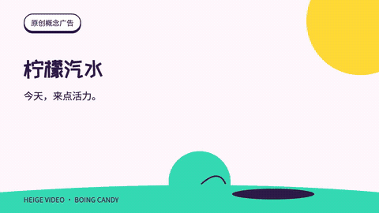
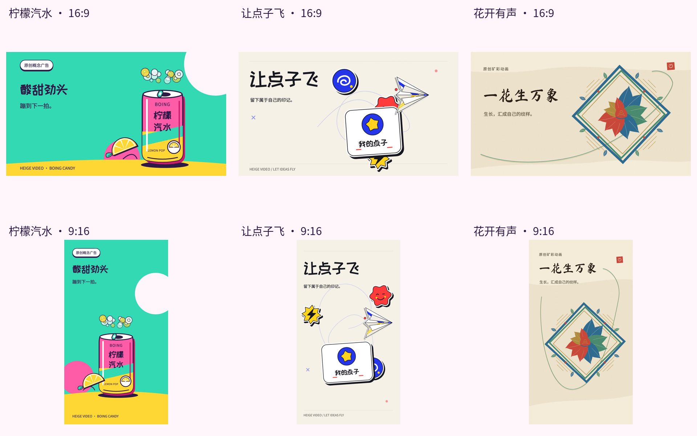

# HeiGe-Video v4.0.0-alpha.3

**Make an idea move. Let one subject carry the pictures, rhythm and outcome.**

Create editable animations in code, from object actions, storyboards and music to rendering and encoded-media checks. The current showcase has **10 colorful original films: 3 landscape films at 16:9 and 7 portrait films at 9:16**. All run for 16 seconds at 30 fps with original music.

| Landscape 16:9: Citrus pop | New portrait 9:16: Berry Cone |
| :--- | :--- |
| [](demos/bright-showcase/citrus-horizontal.mp4) | [](demos/portrait-cases/berry-portrait.mp4) |
| [Landscape MP4 with sound (1280×720)](demos/bright-showcase/citrus-horizontal.mp4) | [Portrait MP4 with sound (1080×1920)](demos/portrait-cases/berry-portrait.mp4) |

GIFs are silent 10 fps previews extracted from the final films. GitHub does not preview larger MP4s on file pages; open an MP4 link and choose **View raw** to download the complete 30 fps film with sound. [All cases](demos/README.md) · [Paired landscape and portrait gallery](demos/bright-showcase/README.md) · [Four new portrait films](demos/portrait-cases/README.md)

## Three themes in both orientations

Citrus pop, Let ideas fly and Mineral bloom each have separately composed landscape and portrait versions. Landscapes are **1280×720**; portraits are **720×1280**. Subjects, text and motion paths are arranged for each aspect ratio.

[](demos/bright-showcase/README.md)

| Theme | Landscape 16:9 | Portrait 9:16 | Direction |
| --- | --- | --- | --- |
| Citrus pop | [MP4](demos/bright-showcase/citrus-horizontal.mp4) | [MP4](demos/bright-showcase/citrus-portrait.mp4) | Candy bounce, squeeze, fizz and landing |
| Let ideas fly | [MP4](demos/bright-showcase/paper-horizontal.mp4) | [MP4](demos/bright-showcase/paper-portrait.mp4) | Paper folds, die-cut stickers and a flight path |
| Mineral bloom | [MP4](demos/bright-showcase/mineral-horizontal.mp4) | [MP4](demos/bright-showcase/mineral-portrait.mp4) | Light paper, growing petals and a mineral motif |

[Animated gallery](demos/bright-showcase/README.md) · [Edit and rerender](showcase/README.md) · [Actual inventory](references/bright-showcase-status.json)

## Four new portrait cases

**1080×1920, 9:16**, with separately authored object actions and an original score for each film. Products and scenes are original concept demonstrations.

[](demos/portrait-cases/README.md)

| Film | MP4 with sound | Object actions | Score |
| :--- | :--- | :--- | :--- |
| Berry Cone | [MP4](demos/portrait-cases/berry-portrait.mp4) | Strawberry mixing, stacked scoops, chocolate pour and landing | Swing marimba |
| Coffee Wake | [MP4](demos/portrait-cases/coffee-portrait.mp4) | Locking, espresso extraction, latte art and steam | Jazz electric piano and brushes |
| Happy Camera | [MP4](demos/portrait-cases/camera-portrait.mp4) | Focus, shutter, continuous physical photo ejection and development | Syncopated funk |
| Pocket Rocket | [MP4](demos/portrait-cases/rocket-portrait.mp4) | Assembly, ignition, curved launch and orbit | Space arpeggio |

[Portrait film gallery](demos/portrait-cases/README.md) · [Editable source and reproduction](portrait-cases/README.md) · [Recorded verification scopes](references/portrait-cases-status.json)

The ten editable Remotion films use original SVGs, bundled local fonts and seven original scores. `showcase/render.mjs` and `portrait-cases/render.mjs` render, decode, measure actual DOM text bounds and record source/artifact hashes. The existing strict JSON production route remains available through `studio/make.mjs`; `init` still creates Forge. Free-form films use separate entry points and do not add entries to the old JSON theme enum.

The earlier [Forge films](demos/forge/README.md) remain another visual direction. The front page now features the bright showcase. Technical checks, sampled visual review, automated playback and human listening are distinct scopes.

[Install and use](USAGE.md) · [Continuity guide](studio/CONTINUITY.md) · [Skill entrypoint](SKILL.md) · [中文](README.md) · [BrewReel study](references/brewreel-distillation.md) · [OneTake study](references/onetake-architecture.md)

## Create your own project

After installing the environment, use one runner to create, validate, build and verify. `init` creates a 15-second Forge JSON project and copies three original local PNGs. For example, `./my-film/project.json` uses `./my-film/project-assets/`. It refuses to overwrite either an existing JSON or asset directory. Keep the relative asset folder with the project when moving it.

```sh
npm ci
python3 -m venv .venv
.venv/bin/python -m pip install -r studio/requirements.txt
# Install local FFmpeg, Noto Sans CJK SC and Chromium as described in the Studio guide.
npx remotion browser ensure
node studio/make.mjs doctor
node studio/make.mjs init ./my-film/project.json --ratio 16:9
node studio/make.mjs validate ./my-film/project.json
node studio/make.mjs build ./my-film/project.json --out ./outputs/my-film-v1
node studio/make.mjs verify ./my-film/project.json --out ./outputs/my-film-v1
```

`--ratio 9:16` and `--ratio 1:1` create independent geometric layouts. Edit the supported contract fields; normal authoring does not require changing the renderer. Native `image` objects bind to registered PNG/JPEG/WebP assets and retain image identity through the global camera and shape trajectories.

## Picture, motion and music in alpha.3

| Mechanism | Actual implementation and bounds |
| :--- | :--- |
| Forge styling | `forge` joins `ledger` and `nocturne`; controlled type size/weight/line height, strokes, hard shadows and film-perforation/stripe/waveform patterns |
| Fast motion | Fixed `linear`, `ease-out-cubic`, `ease-in-out-cubic`, `ease-out-expo` and `back-out` curves; pure time evaluation, with easing controlling the keyframe's outgoing interval |
| Local images | `image.assetId` must bind to a registered image; original image identity survives controlled cover cropping; the template uses three original PNGs |
| Complete score | `forge-breakbeat`: 128 BPM, 4/4, eight bars and 15 seconds; original drums, syncopated bass, chord stabs, lead hook and lift generate a real stereo WAV |
| Shared cues | Strike, drive, charge, format rearrangement and seal share the second clock; video beat quantization stays within half a frame, without pretending every music beat is an integer frame |
| Mixing | Score gain is applied once; only narration ducks the bed, event effects mix at fixed gain, and the final mix is limited and measured |

`continuity.musicScore: {style: "forge-breakbeat", bpm: 128, volume: 0.8}` currently requires exactly 15 seconds and excludes external `project.music`. Other durations can use registered local music. Final narration still determines its film's clock. The complete arrangement, peak and RMS do not establish listening quality. Read the [original score note](references/music-score.md) for source and review limits.

## Controlled production in v4

| Capability | Current implementation |
| :--- | :--- |
| Authoring | Shared `init`, `validate`, `build`, `verify`; `promo`, `explainer`, `lesson`, `talk`; three themes and three ratios |
| Continuous world | Persistent IDs, full trajectories, global camera and explicit adjacent-beat handoffs; no ordinary scenes mixed into a continuous world |
| Temporal blur | Optional three actual temporal samples at a 180-degree global shutter, averaged in linear-light sRGB before encoding; one sample disables it |
| Ordinary scenes | `hook`, `statement`, `steps`, `compare`, `bars`, `transform`, `media`, `end` remain available |
| Voice and facts | Final-recording timing, original SRT cues, preview-only mock/draft, literal claim attribution and own-object numerical evidence; labelled teaching data |
| Media and layout | Registered local assets, safe paths, declared rights, independent layouts, glyph coverage and actual browser geometry |
| Encoded QA | Complete video decoding and separate narration/final-mix measurements; per-frame continuous DOM geometry, approximate visibility and final-MP4-bound pixel changes |
| Integrity | Input, caption, asset, engine, dependency, font, browser and artifact hashes; changed sources invalidate earlier verification |

Continuous worlds remain bounded to 60 seconds and 2 to 20 beats, each 0.25 to 20 seconds after frame quantization. Cause/outcome are author declarations. Point-grid visibility and pixel differences cannot prove narrative semantics, real product behavior, perceptual identity or artistic quality. Three temporal samples add computation; they are not physical HDR or per-object velocity blur. Facts and text inside image pixels still need human review.

A coding agent reads the Skill and authors JSON. Local rendering needs no model API key. Native online LLM, TTS, ASR and B-roll supply/cache remain unintegrated. BrewReel and OneTake informed method research; no upstream source or assets were imported. Alpha software and hash integrity are not a trust certificate, aesthetic approval, playback review or listening review. See the [Studio guide](studio/README.md), [contract](studio/CONTRACT.md) and [source notices](references/source-notices.md).

## Historical alpha.2 continuous films

The [landscape](demos/continuous/horizontal.mp4), [portrait](demos/continuous/portrait.mp4) and [square](demos/continuous/square.mp4) films remain historical continuity examples. The user rejected their pacing and aesthetics and identified the missing complete BGM. Their historical `sampled-pass` only states the documented sampling scope; it is not user approval or evidence for Forge aesthetics. The [gallery](demos/continuous/README.md), [alpha.2 inventory](references/v4-continuity-status.json) and [historical delivery record](references/v4-continuity-report.md) retain that version's evidence.

## Five historical v4 alpha 1 films

The five [encoded examples](demos/super/README.md) retain their original bytes, source inputs and scoped acceptance records: median landscape, median portrait, product portrait, an audio-clock fixture and a local-media square fixture. The [portable inventory](references/v4-example-status.json) binds them to source commit `29135480806d061f1af65734b17dcecad3a31f4a`. Historical verification recomputes the production engine hash from that Git commit and fails when the commit is unavailable. These historical results do not establish acceptance of the alpha.3 engine or Forge films.

The original inventory records sampled review and muted normal-speed browser playback. The audio fixture's first playback dropped frames and its independent replay did not; both records remain. Audio was measured but not listened to. Mock/draft fixtures remain preview, and no real spoken-narration experience is claimed.

## Five preserved v3 original films

### Night Signal

30 s · 1080p · original synthesized sound. One poster becomes a rhythm instrument.

https://github.com/user-attachments/assets/1099994b-4ec2-4553-a94b-3c98fe149200

[MP4](demos/swiss-editorial-v3.mp4) · [Source and reproduction](examples/swiss-editorial/README.md)

### SPECTRA

36 s · 720p · original synthesized sound. Source objects become evidence, storyboard, timeline and an optical scene.

https://github.com/user-attachments/assets/740bf648-3140-4980-a571-0edb1af79381

[MP4](demos/spectra-product-v3.mp4) · [Source and reproduction](examples/cinematic-product/README.md)

### Homeward

36 s · 720p · silent. A boat changes course, visibly docks and comes to rest.

https://github.com/user-attachments/assets/84201db2-fc4e-47c5-997a-b54ecf40af07

[MP4](demos/homeward-ink-v3.mp4) · [Source and reproduction](examples/ink-narrative/README.md)

### 38 Microseconds

42 s · 1080p · silent. One persistent board explains GPS and relativity.

https://github.com/user-attachments/assets/b3ee0e0a-bdc0-4db8-a041-245a720380d8

[MP4](demos/gps-relativity-v3.mp4) · [Source and reproduction](examples/whiteboard-navigation/README.md)

### Unpacking an Average

23.25 s · 720p · silent. The same orders become a readable distribution.

https://github.com/user-attachments/assets/690365d1-e2f4-411e-8178-d0c30952e0fe

[MP4](demos/unpacking-average-v3.mp4) · [Source and reproduction](examples/dataviz-forward/README.md)

All five have continuous technical exports and scoped independent decoded-image acceptance after repairs. The first two contain original synthesized sound, measured but unheard; the other three are silent. This does not establish complete playback, all-frame artistic review, reference parity or a model-cost advantage.

See [current status](references/status.md), [versioned source/media hashes](references/v3-example-status.json) and the [Chinese upgrade report](UPGRADE_REPORT_ZH.md). Five older v2 films remain explicitly labelled regression/comparison material.

## What changes in v3

- Direction centered on persistent objects, visible state changes and an ending that reframes the opening
- Canvas authored duration, asset readiness, pure-time state, declared text and hard cuts; shared cues, camera, stroke and seeded-noise helpers
- Decoded MP4 action/cut strips with exact time mappings and hashes; actual-pixel inspection and repair rather than automatic aesthetic approval
- 100 distinct works and 100 canonical repositories, with concrete mechanisms, limitations and rights notes; a small offline selector retrieves only a few relevant references

[Implemented features versus research proposals](references/upgrade-mechanisms.md) keeps future ideas separate from current capabilities. More rules or style names do not guarantee stronger pictures.

## Start

Copy the complete folder into your agent's supported skills directory, or have the agent read `SKILL.md` in a project. Rendering existing source needs no model SDK or API key. Creating and judging new work needs file access, code execution, rendering and actual-image review.

```sh
git clone https://github.com/HeiGeAi/HeiGe-Video.git
cd HeiGe-Video
python3 runtime/render_video.py doctor
python3 scripts/select_references.py --style ink --query 'brush identity consequence' --limit 4
python3 scripts/validate_package.py
```

Example request:

> Use heige-video to make an original 20-second explanation of why the median resists outliers. Use clearly labelled synthetic data. Design the ending first. Make the same values undergo two visibly different statistical operations. Render the signature action before making the full film, inspect actual pixels and state unverified playback or sound checks.

See [USAGE.md](USAGE.md) for explicit Canvas source commands and QA. The compatibility presets `--style tech/whiteboard/ink` still select **legacy v2 SVG examples**, not upgraded v3 films.

## Research scope

The [video index](references/research-cases.md) retains 79 mechanism references, 3 case-study/tutorial references, 1 mixed reference and 17 controls. It includes 51 freshly reinspected baseline works plus 49 new works. Per-work coverage and media hashes are recorded. Sampling varies and can be sparse for long films; it does not establish uninterrupted playback, listening or all-frame review. This is not a list of 100 excellent films.

The [project index](references/research-projects.md) contains 50 agent/authoring/orchestration projects and 50 render/motion/QA projects. Instruction/specification skills are labelled. Targeted source code was inspected; third-party projects were not installed, built or run. A demo link does not establish runtime validation.

```sh
python3 scripts/select_references.py --kind videos --style swiss-tech --limit 3
python3 scripts/select_references.py --kind projects --query 'font shaping' --limit 3
python3 scripts/select_references.py --controls only --limit 3
```

Controls are excluded by default. Selection is lexical routing, not quality scoring. Author model claims remain unverified. No controlled model comparison, cost advantage or Opus parity is established.

## Package map

- [SKILL.md](SKILL.md): concise creative workflow and style routing
- [USAGE.md](USAGE.md): installation, commands, review and tests
- [Runtime contract](references/runtime-adapter.md): Canvas/SVG API, helpers and decoded QA
- [Quality gates](references/quality-gates.md): technical, meaning/style and perceptual review
- [Video JSON](references/research-cases.json) / [Project JSON](references/research-projects.json): portable research without private paths

Remotion + FFmpeg is the default controlled-production route. Authored Canvas/SVG + FFmpeg remains supported for bespoke films. The separate legacy browser adapter is experimental, and a successful Blender CPU probe is not a general full-film implementation.

## License

Original code and documentation retain the [MIT License](LICENSE), existing copyright and [third-party notices](references/source-notices.md). Reference movies, source frames, music, fonts and third-party source snapshots are not distributed in the research corpus. A repository code license does not automatically grant media rights. Dependencies remain subject to their own licenses.

This is v4.0.0-alpha.3, dated 2026-10-12. OneTake's fixed research commit uses a noncommercial license. No OneTake source or assets were imported; this project's MIT license does not grant rights to reuse upstream materials. See the [source notices](references/source-notices.md) and [changelog](CHANGELOG.md).
