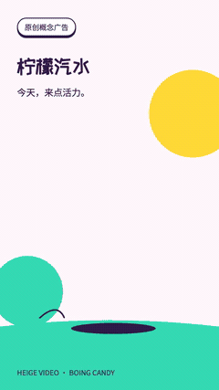
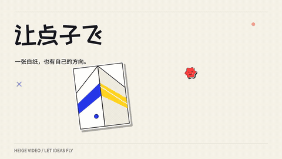
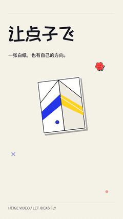
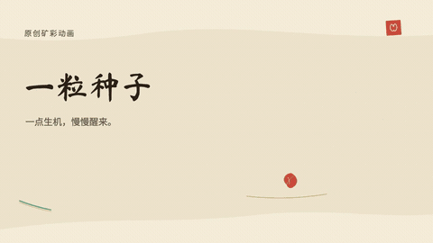
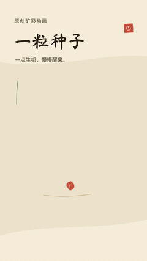

# 六条明亮样片

三种题材，各自制作横版和竖版。每条 16 秒、30 fps，包含完整原创配乐。点击动图打开带声音的 MP4；GIF 为实际成片的 10 fps 静音预览，无法代替原视频的帧率与声音。

## 柠檬汽水

棉粉、薄荷、柠檬黄。柠檬挤压接汁，罐体开环、喷泡、跳起和落地。明快的 mallet pop 配乐与具体动作音效共用 120 BPM 时钟。这是明确标注的原创概念广告。

| 横版 16:9 | 竖版 9:16 |
| --- | --- |
|  |  |
| [带声音的 MP4](citrus-horizontal.mp4) | [带声音的 MP4](citrus-portrait.mp4) |

## 让点子飞

奶油白、钴蓝、樱桃红、明黄。白纸沿折痕收成纸飞机，沿曲线转向、滚转，经过模切贴纸，最终留下自己的创意印记。配乐为原创拨弦与轻鼓。

| 横版 16:9 | 竖版 9:16 |
| --- | --- |
|  |  |
| [带声音的 MP4](paper-horizontal.mp4) | [带声音的 MP4](paper-portrait.mp4) |

## 花开有声

明亮纸面、石青、石绿、朱砂和土金。一粒种子发芽，枝叶与莲瓣分别展开，汇聚成偏轴矿彩纹样。书法字形、颜料颗粒和五声音阶形成另一种气质。这是原创矿彩植物动画，不是壁画复原。

| 横版 16:9 | 竖版 9:16 |
| --- | --- |
|  |  |
| [带声音的 MP4](mineral-horizontal.mp4) | [带声音的 MP4](mineral-portrait.mp4) |

## 源码与检查

六条实际 MP4、动图和封面均在本目录。封面与 GIF 从最终编码视频提取，没有用另做的效果图代替成片。[源码与渲染方法](../../showcase/README.md)可以继续编辑文案、图形、动作、轨迹和配乐。

每条独立构图，横版 1280×720、竖版 720×1280。实际输入、源码、产物哈希及各项检查状态见 [清单](../../references/bright-showcase-status.json)。图像视审是抽样范围，自动浏览器播放保持静音，人工完整观看和听审尚未完成。

三支配乐均由本项目原创编排与程序化音色生成，无采样包或参考旋律：[汽水](citrus-music.wav)、[纸飞机](paper-music.wav)、[矿彩](mineral-music.wav)。本地字体来自 OFL 字体重命名子集，来源和许可见 [字体记录](../../showcase/font-provenance.json)。
