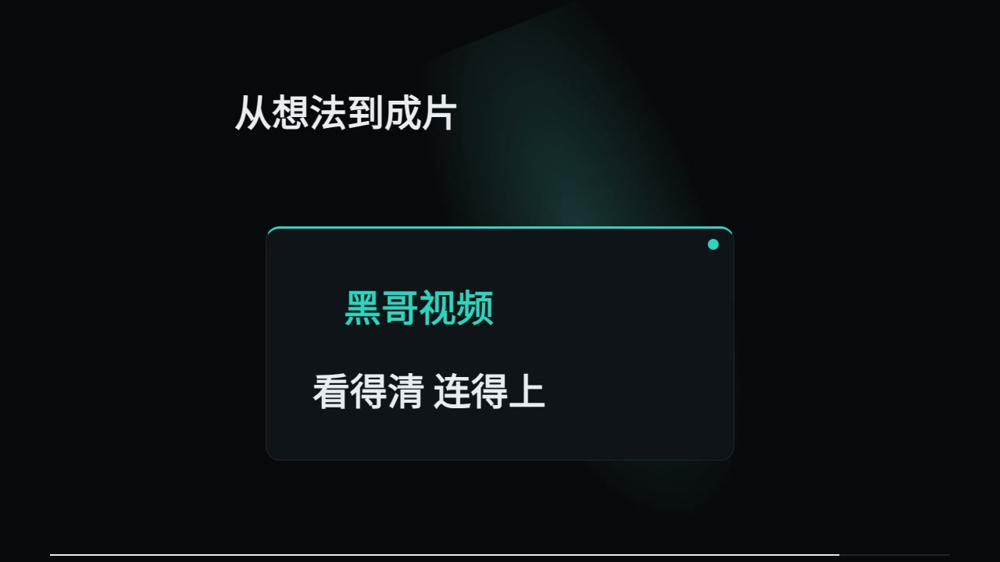
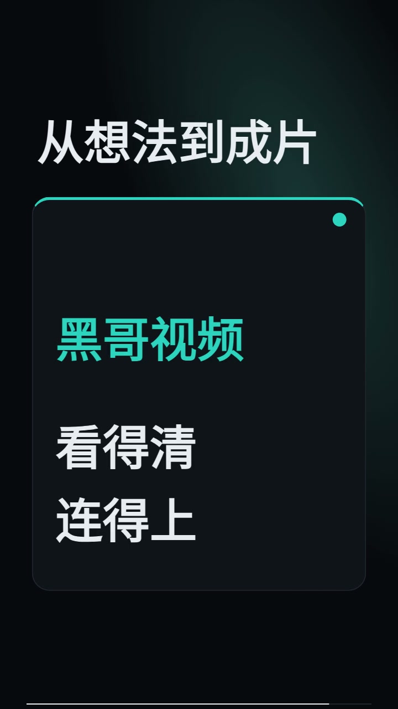
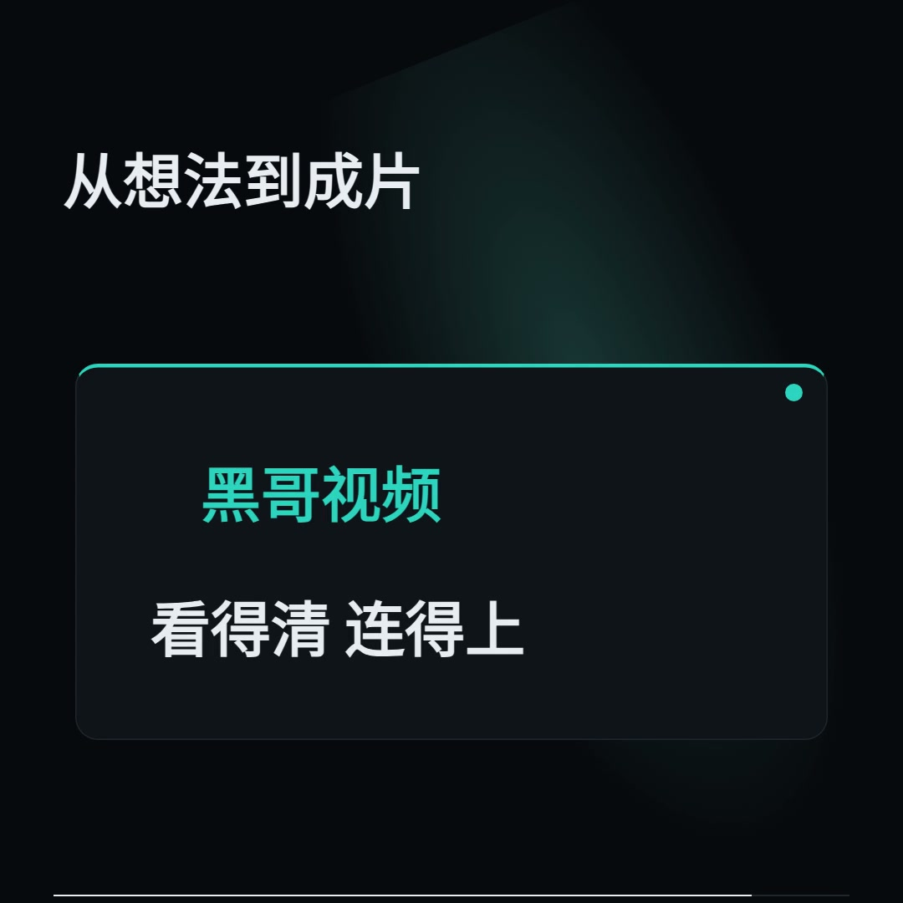

# HeiGe-Video 原创连续世界演示

本页用于 `4.0.0-alpha.2` 的独立三画幅成片。生产实现包含持久对象、全局镜头、按对象位置触发的原创音效和实际三次浏览器曝光。

三条均由当前引擎实际构建并 verify，每条 16 秒、30 fps、480 个编码帧，总计 48 秒、1,440 帧与 4,320 次实际浏览器曝光。构建使用单个渲染并发。各画幅分别设计几何与收尾排版。

| 成片 | 规格 | 验收结果 |
| --- | --- | --- |
| [横版 MP4](horizontal.mp4) | 1280×720，16:9 | build、verify、480 帧解码与 DOM、三个承接边界通过；抽帧视审通过 |
| [竖版 MP4](portrait.mp4) | 720×1280，9:16 | 同上；收尾两行各三个字，实际编码与生产组件排版回归通过 |
| [方版 MP4](square.mp4) | 1080×1080，1:1 | build、verify、480 帧解码与 DOM、三个承接边界通过；抽帧视审通过 |

系统 Google Chrome 155.0.8059.39 自动以正常速度、持续静音从 0 播放至 ended。每条均解码并呈现 480 帧，观测丢帧 0，视频和页面错误 0。这个结果不是完整人工观看或听音批准。音频完成全部声道的解码、时长、峰值、RMS 与有限数检查，实际听音仍为 `not-tested`。

独立视审覆盖每条的 25 格总览、三个边界共 48 格条带，以及 18 张满分辨率编码帧。横版与已经审过的 v2 MP4 同字节，本次重新核验当前引擎、输入与全部媒体并重新解码，视审证据绑定相同像素；没有冒充不同视频的观看。原始曝光 PNG 在合成后删除，保留逐曝光与合成哈希，没有宣称独立重新合成。

点击实际 MP4 第 420 帧（14 秒）截帧观看视频：

[当前引擎、输入及 MP4 哈希清单](../../references/v4-continuity-status.json) · [真实测试与修复记录](../../references/v4-continuity-report.md) · [原创项目与使用指南](../../studio/CONTINUITY.md)。`python3 scripts/validate_continuous_release.py` 核对清单与当前文件，不重渲、不解码、不播放、不听音。

稳定阅读段有明确保持。结构与抽帧通过不代表所有题材的宣传节奏、叙事语义或音乐听感已经得到验证。示例为本项目原创机制演示，没有展示真实产品操作、真人录音或在线生成供应商。

已有五条历史受控样片见 [super](../super/README.md)，历史源码固定提交的证据不代表本版重新渲染。
