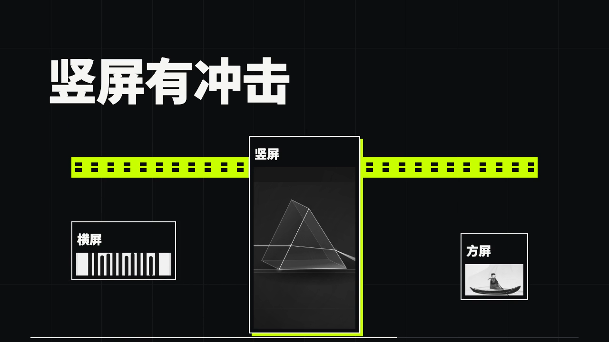

# 熔炉原创短片

HeiGe-Video v4.0.0-alpha.3 的三种独立构图。铁黑、近白、酸绿、真实原创画面与机械压印来自 `forge-anvil`，未复用上游源码或作品素材。

| 成片 | 项目 |
| --- | --- |
| [横版](horizontal.mp4) | [forge-launch.json](../../examples/studio/forge-launch.json) |
| [竖版](portrait.mp4) | [forge-portrait.json](../../examples/studio/forge-portrait.json) |
| [方版](square.mp4) | [forge-square.json](../../examples/studio/forge-square.json) |

三条均为 15 秒、30 fps，每个编码帧使用三次实际曝光采集。三种构图分别制作，画面、文字、标签和相机都在同一个可寻址时间轴内。

配乐是项目内原创的 [forge-breakbeat.wav](forge-breakbeat.wav)。影片支持编辑所有文本、轨迹、登记图像与画幅；这支配乐预设目前固定 15 秒和 128 BPM，其他时长可用现有外部本地音乐资产。

实际哈希和分项状态以 [清单](../../references/v4-forge-status.json) 为准，返工与验证见 [记录](../../references/v4-forge-report.md)。三条的技术检查和独立抽样视审已通过；正常速度自动 Chrome 播放均到达结尾，零丢帧，保持静音。尚未完成人工听音和正常速度人工完整观看，不能据此宣称配乐好听或用户审美验收通过。旧 alpha 2 样片的审美否决仍保留。
