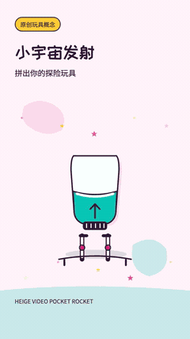

# 四条 9:16 竖版案例

四种题材，四支原创配乐。每条 1080×1920、30 fps、16 秒，横竖比严格为 9:16。点击动图打开带声音的 MP4。GIF 是实际成片提取的 10 fps 静音预览。

| 莓好一口 | 咖啡醒醒 |
| :--- | :--- |
|  |  |
| [播放带配乐的 MP4](berry-portrait.mp4) | [播放带配乐的 MP4](coffee-portrait.mp4) |

| 快乐开拍 | 小宇宙发射 |
| :--- | :--- |
|  |  |
| [播放带配乐的 MP4](camera-portrait.mp4) | [播放带配乐的 MP4](rocket-portrait.mp4) |

「莓好一口」用草莓、蛋筒、冰淇淋叠球与淋酱完成一次弹跳糖动作。「咖啡醒醒」把咖啡机锁入、萃取、落杯与奶纹画成连续操作。「快乐开拍」让玩具相机真实伸镜、按快门和吐出实体照片。「小宇宙发射」让同一支火箭装配、点火和绕过亮色行星。所有产品与场景均为原创概念演示。

[可编辑源码与渲染命令](../../portrait-cases/README.md) · [输入与检查清单](../../references/portrait-cases-status.json) · [原六条横竖样片](../bright-showcase/README.md)

动图、封面均从最终 MP4 提取。原始配乐为本项目的确定性程序化乐器，分别是 [马林巴](berry-music.wav)、[爵士电钢](coffee-music.wav)、[切分 funk](camera-music.wav)、[太空琶音](rocket-music.wav)。本地字体使用保留许可与来源的 OFL 重命名子集。

检查清单区分完整解码、抽样视觉审阅、正常速度自动播放与人工听音，不把构建成功写成审美通过。
