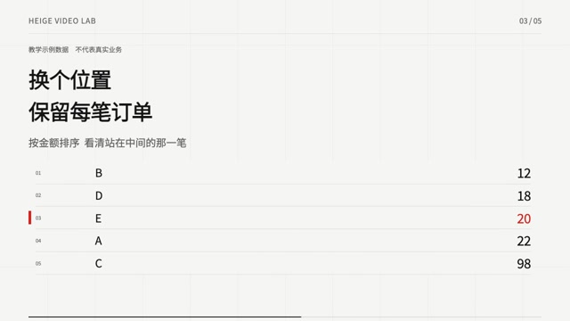
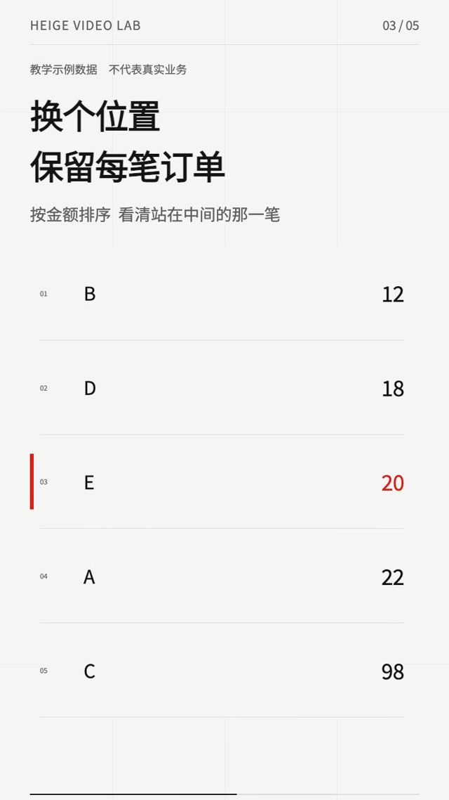
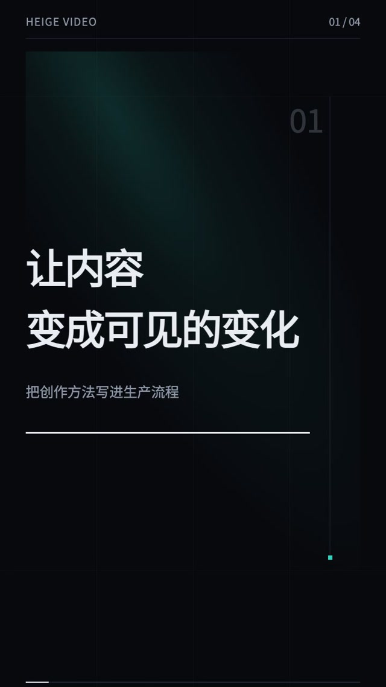
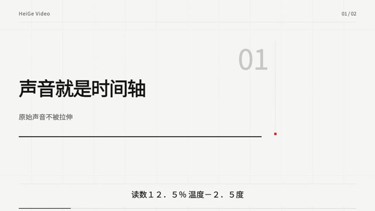
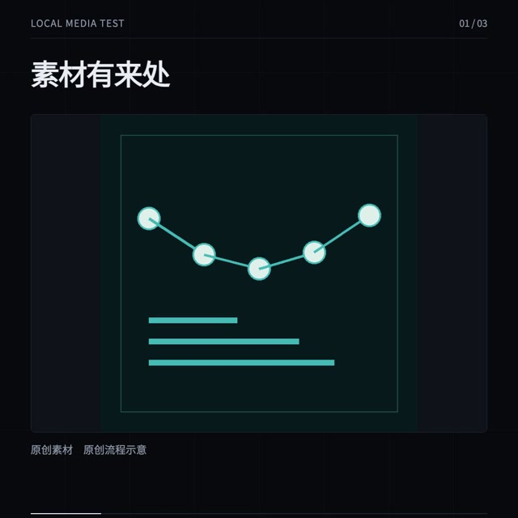

# HeiGe Video v4 实际样片

五条均由同一最终引擎实际渲染，总计 74 秒、2,220 个编码帧。它们分别检验信息动作、横竖构图、产品表达、声音时钟与本地媒体。数据为明确标注的教学示例，声音为原创程序合成；没有冒充真人旁白。

| 样片 | 规格 | 检验内容 | 输入与状态 |
| :--- | :--- | :--- | :--- |
| [中位数横版](median.mp4) | 20 秒，1280×720，30 fps | 同一批订单、零基线柱图、可见排序、中间项与平均数比较 | [JSON](../../examples/studio/median.json)，validated，原创合成配乐 |
| [中位数竖版](median-portrait.mp4) | 20 秒，720×1280，30 fps | 相同对象与数值，独立竖版构图和上下比较分组 | [JSON](../../examples/studio/median-portrait.json)，validated，原创合成配乐 |
| [产品竖版](product.mp4) | 18 秒，720×1280，30 fps | 暗色光束、步骤推进、两条生产路线与结尾回收 | [JSON](../../examples/studio/product.json)，validated，静音 |
| [声音时码夹具](audio-clock.mp4) | 8 秒，1280×720，30 fps | 原时码、合成音混音、全角小数／负号／百分号／比例符号保留 | [JSON](../../examples/studio/audio-clock-mixed.json)，mock 固定 preview |
| [本地媒体方版](media-square.mp4) | 8 秒，1080×1080，30 fps | 本地原创图片及视频解码、容器布局、素材身份显示 | [JSON](../../examples/studio/media-square.json)，draft 固定 preview，静音 |

`validated` 只代表完成本次技术检查。抽帧审阅、静音自动完整播放及实际听音分开记录，见 [版本化验收清单](../../references/v4-example-status.json) 与 [升级报告](../../references/v4-upgrade-report.md)。程序测量声音不代表实际听过声音；preview 不因出片成功提升为正式交付。

点击实际成片截帧观看 MP4：

复核：`python3 scripts/validate_super_release.py`（从仓库根运行）。重新渲染请使用 [Studio 指南](../../studio/README.md) 中的显式环境安装、build 和 verify 命令，每次选择新的输出目录。

全部新增画面、程序合成声音与输入素材为本仓库原创，沿用 MIT。没有分发参考项目影片、音乐、字体或角色。Remotion 与系统工具保留独立许可。
