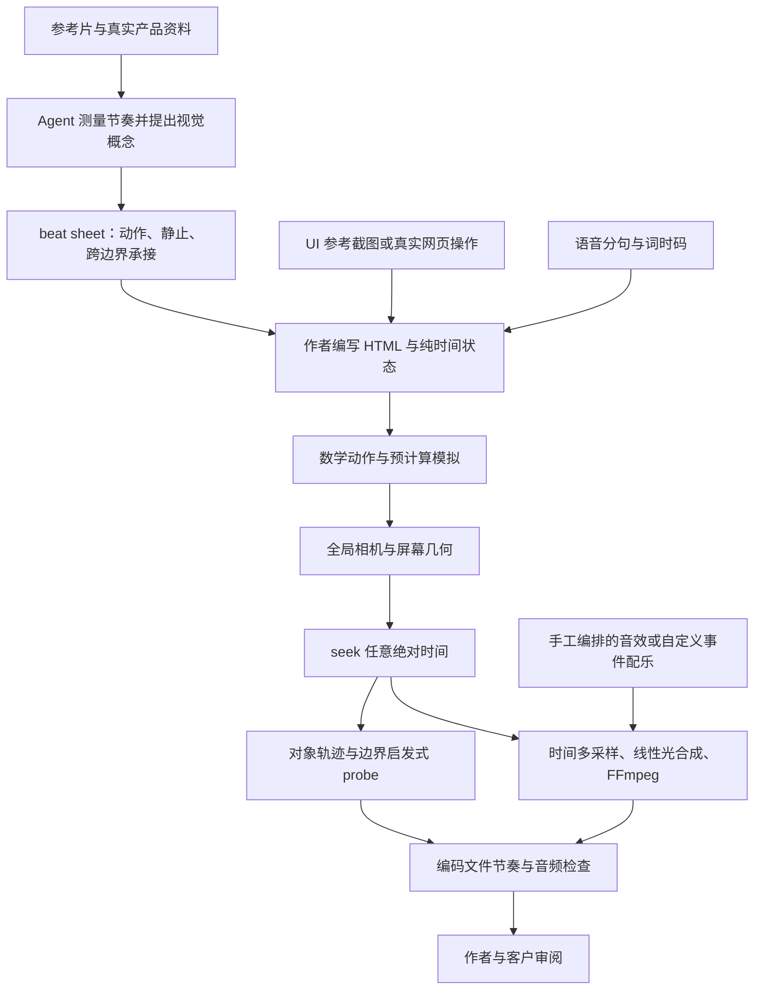

# OneTake 架构研究与 HeiGe Video 的原创融合设计（集成前快照）

研究日期：2026-10-12。本文第 1 至 11 节保留为 **2026-10-12 的集成前架构研究快照**；其中「当前」「未来」「应新增」描述的是当时的阶段，不能据此判断 alpha 2 的现有能力。集成后的实际状态见下方第 0 节、[集成记录](onetake-integration.md) 与 [连续世界指南](../studio/CONTINUITY.md)。

上游基准固定为 [feitangyuan/onetake，提交 2f5fbd363a0aec22055fbf62489380065737c91d](https://github.com/feitangyuan/onetake/tree/2f5fbd363a0aec22055fbf62489380065737c91d)，提交时间为 2026-10-10。公开动作库标识为 `1.1.0-lite`。上游分析以该提交的源码为依据，不把网站、案例说明或作者自报验收数值视为本轮实测。

**研究时的优先建议是吸收持续对象、边界动作与同一时钟，保留本项目执行器。** 集成前，HeiGe 的 Canvas 路线已经有原创弹簧、相机矩阵、对象噪声和时间采样模糊；Remotion 路线已经有严格事实、录音时钟、实际浏览器几何和最终编码检查。真正值得补齐的是：观众能在前后两个 beat 中认出同一个对象，看清它如何引发下一状态，并让相机、声效与检验共享这条因果记录。增加弹簧或淡入淡出种类，不能单独解决画面像轮播卡片的问题。

本快照记录静态源码研究与融合设计。该研究没有执行上游渲染、Kokoro、Whisper 或音效程序，没有试听、完整播放其案例，也没有取得上游案例的源代码。上游后续反例研究另见 [质量研究](onetake-quality.md)。本项目未复制上游代码、模板、字体、音乐、图像或视频。第 9 节的概念字段与第 10 节的实施顺序是集成前建议，不能直接作为当前 JSON 契约使用；已接受字段与精确限制以生产指南为准。

## 0．alpha 2 集成后的实际状态映射

| 集成前建议 | 当前原创实现 | 仍须区分的边界 |
| :--- | :--- | :--- |
| 有限持久对象舞台 | [continuity-contract.mjs](../studio/lib/continuity-contract.mjs)、[ContinuousStage.tsx](../studio/src/ContinuousStage.tsx) 定义稳定对象 ID、身份声明、完整轨迹和 `beat` 时间段，普通镜头不能混入连续世界。 | 身份文字是作者声明，几何连续不能证明观众理解了身份或故事。 |
| 全局相机与纯时间状态 | [continuous-motion.mjs](../studio/lib/continuous-motion.mjs) 在统一影片时钟求值对象与相机，世界层与屏幕层明确分开。 | 本版为二维仿射相机，没有自动跟拍、三维透视或通用物理场景。 |
| 对象与声音共享事件时钟 | [event-audio.mjs](../studio/lib/event-audio.mjs) 已接通原创 `tick`、`whoosh`、`impact`，绑定对象、时间与声像，并输出事件报告。 | 不是 TTS、自动作曲或听音批准；声音舒适度仍需人工听审。 |
| Remotion 时间积分模糊 | [make.mjs](../studio/make.mjs) 已接通三个真实浏览器曝光，[blur_frames.mjs](../studio/blur_frames.mjs) 在线性光 sRGB 中平均，再编码为最终帧。 | 当前是可选三曝光、180° 全局快门，未实现自适应采样、HDR 或逐对象速度模糊。 |
| 声明边界必须有真实证据 | [continuity-oracle.mjs](../studio/lib/continuity-oracle.mjs) 检查完整帧 DOM 覆盖、承接可见性与运动，绑定最终 MP4 的像素变化；[continuity-evidence.mjs](../studio/lib/continuity-evidence.mjs) 在 verify 中复核记录。 | 点阵遮挡和低分辨率灰度变化是结构诊断，不具有图像或因果语义。 |
| 保留事实、录音、素材和交付约束 | `init`、`validate`、`build`、`verify` 使用同一执行器，连续对象数值引用自己的 claims；录音／字幕、素材与当前源码指纹继续约束输出。 | 没有原生在线 LLM、TTS、ASR、B-roll 供应缓存或自动截图重建 UI。 |

当前连续世界限 60 秒、2 至 20 个 beat，每段量化后为 0.25 至 20 秒。受控 UI 表达的是作者提供的文字与界面行，不是任意 HTML 执行器或真实应用操作证明。v3 Canvas 的自由导演路线与五条 alpha 1 历史样片均保留；旧提交的验收不能证明当前引擎。

具体实现、真实失败与修正过程由 [onetake-integration.md](onetake-integration.md) 记录。实际成片与抽帧范围见 [连续样片目录](../demos/continuous/README.md)，哈希与声明检查见 [本版清单](v4-continuity-status.json)。本文不补写未收到的渲染数字、播放结果或人工听音结论，下面的上游分析与早期建议继续保留原研究时点。

## 1．它是一套创作协议与脚本集合

OneTake 的生产单位是作者编写的单份 HTML composition，由绝对时间函数决定 DOM 与 Canvas 的完整状态，再通过 Playwright 截图编码。它没有公开的自然语言到成片自动规划服务，没有统一严格的业务 JSON 编译器，也没有自动从截图生成完整 UI 的引擎。

创作流程在 [SKILL.md：39～188](https://github.com/feitangyuan/onetake/blob/2f5fbd363a0aec22055fbf62489380065737c91d/SKILL.md#L39) 中规定八步：测量参考，提出不同视觉概念，选择概念并安排节奏与承接，采集或重建真实 UI，编写 composition，先草稿后高分辨率，制作声音，再验证。这些是 Agent 要遵守的工作协议，代码不会强制证明作者完成了每一步。

值得保留的创作判断有三项。概念应描述画面本身的统一机制，而不是换三个文案标题；每个重要边界要指出什么对象存活、怎么运动、下一状态如何由它生成；静止阅读窗与动作爆发共同形成节奏。上游的「至少四倍镜长变化」「大量留白」「静止占比」来自短产品片经验，不能直接作为所有课程、口播或竖版影片的通用规则。

## 2．能力与边界的源码对照

| 机制 | 固定提交中的真实能力与定位 | 不能推导的能力 |
| :--- | :--- | :--- |
| 连续镜头 | 作者通过同一 composition 的 `seek(t)` 和世界坐标安排全片，承接原语返回几何状态。[template：180](https://github.com/feitangyuan/onetake/blob/2f5fbd363a0aec22055fbf62489380065737c91d/templates/comp.html#L180)、[motion：185](https://github.com/feitangyuan/onetake/blob/2f5fbd363a0aec22055fbf62489380065737c91d/lib/motion.js#L185) | 任意输入都会自动获得一镜到底。模板自身仍有独立 prompt、panel、飞入页面、硬切文字等段落。 |
| 持久对象 | 同一 DOM 元素、绘制标识或作者自报 `__track` ID 可跨时间存在，运动函数只返回数值。[probe：38](https://github.com/feitangyuan/onetake/blob/2f5fbd363a0aec22055fbf62489380065737c91d/scripts/probe.py#L38) | 没有通用对象生命周期管理器、父子 scene graph 或自动语义对象追踪器。 |
| 相机 | `camera()` 在键之间插值位置、旋转与 log zoom；`view()` 输出层级深度对应的仿射矩阵。[motion：344](https://github.com/feitangyuan/onetake/blob/2f5fbd363a0aec22055fbf62489380065737c91d/lib/motion.js#L344) | 不是真实三维摄影机，不具备透视体积、遮挡求解或自动跟拍构图。 |
| 运动数学 | 缓动、cubic Bézier 求解、三类阻尼弹簧、导数、Hermite 轨迹与固定种子 RNG。[motion：58](https://github.com/feitangyuan/onetake/blob/2f5fbd363a0aec22055fbf62489380065737c91d/lib/motion.js#L58) | 数学有限不等于画面有意义；库没有完整输入 schema，也不会替作者选择合适曲线。 |
| 接触与模拟 | magnet、follow、jelly、verlet 根据共享 hand 轨迹预计算，按绝对时间查表。[motion：280](https://github.com/feitangyuan/onetake/blob/2f5fbd363a0aec22055fbf62489380065737c91d/lib/motion.js#L280) | 不是一般物理引擎，不支持任意碰撞几何或动力学约束。 |
| UI 重建 | stage 坐标映射、DOM 局部测量、宽度重排、高亮和字号计算。[ui_kit：17](https://github.com/feitangyuan/onetake/blob/2f5fbd363a0aec22055fbf62489380065737c91d/lib/ui_kit.js#L17) | 不会解析截图生成 HTML，不会证明复刻与真实产品一致，也不会自动去除账户信息。 |
| 多语言时钟 | 单调分段线性映射及逆映射，字幕使用影片时间，动作可使用作者时间。[ui_kit：72](https://github.com/feitangyuan/onetake/blob/2f5fbd363a0aec22055fbf62489380065737c91d/lib/ui_kit.js#L72) | 语义等价锚点由作者指定；没有自动翻译、自动跨语言对齐与质量保证。 |
| 语音工具 | Kokoro 分句合成，Whisper 词时码，按句长生成起点，字幕分块。[vo_tools：56](https://github.com/feitangyuan/onetake/blob/2f5fbd363a0aec22055fbf62489380065737c91d/scripts/vo_tools.py#L56) | CJK 字幕部分使用发音长度估计与附近停顿，不是中文逐字强制对齐。 |
| 事件声音 | 六类合成材料、立体声放置、共同合成混响和峰值归一化。[sfx_palette：39](https://github.com/feitangyuan/onetake/blob/2f5fbd363a0aec22055fbf62489380065737c91d/scripts/sfx_palette.py#L39) | 公开模板手工填声音时间；自动 `__events` 导出器与案例 `score.py` 未在公开文件树中提供。 |
| Motion blur | 快门区间多次 seek，sRGB 转线性光后平均，再转回编码值。[render：74](https://github.com/feitangyuan/onetake/blob/2f5fbd363a0aec22055fbf62489380065737c91d/scripts/render.py#L74) | 不是 CSS blur；也不是物理场景光线积分、HDR 或逐对象速度缓冲模糊。 |
| 自动验收 | 轨迹、可见面积、运动速度、静止、节奏和音频峰值的启发式规则。[verify：57](https://github.com/feitangyuan/onetake/blob/2f5fbd363a0aec22055fbf62489380065737c91d/scripts/verify_promo.py#L57) | 不能证明创意、事实、产品准确性、音质或完整观看体验；未绑定输入与成片哈希。 |

公开案例目录包含影片与 README，而没有案例 composition、数据生成器与配乐源码。因此 README 中的连续性分数、渲染成本与被客户接受的记述属于作者记录，本轮不能复算，更不能据此证明模型能力或与 HeiGe 的优劣。

## 3．连续镜头先设计交接，再选择效果

上游的承接原语可分成四种关系。容器变化包括矩形的中心、尺寸、圆角连续变化；由主体发出的开场包括圆形遮罩向外覆盖画面；相机进入一个容器直到它充满屏幕；多个现有对象汇聚成结束结构。具体函数为 `morphRect`、`iris`、`zoomThrough`、`gather`、`ribbon`、`seal`，集中在 [motion.js：183～242](https://github.com/feitangyuan/onetake/blob/2f5fbd363a0aec22055fbf62489380065737c91d/lib/motion.js#L183)。

这些函数只计算矩形、圆、位置或缩放。下一画面出现什么、何时切换材质、旧对象是否被遮挡、数据是否保持，全部由 composition 作者负责。保持一个移动光标或一个不变的大背景，也不必然构成叙事承接。需要核对载体在前后画面是否承担相同可理解的身份，以及变换是否解释了内容关系。

适合 HeiGe 的第一组原创动作是「同一条记录从列表进入分组，再进入统计结果」「选中的 UI 菜单项进入输入框并触发真实状态」「原因对象接触结果对象后，结果状态发生可读变化」。它们同时改善讲解与动作，容易保留事实 ID，也容易制作边界前后条带。全片不断缩放、无阅读窗的相机飞行，对长课和连续口播的收益较低。

## 4．运动数学的可迁移原理

上游采用绝对时间与确定性数值函数。缓动函数定义归一化进度；`t80()` 估计走过八成距离所需的时间占比；弹簧以阻尼比与频率决定落定和超调；`springVel()` 将速度用于挤压；`spline()` 为指针生成共享路径。相关代码与数值检查分别见 [motion.js：26～125](https://github.com/feitangyuan/onetake/blob/2f5fbd363a0aec22055fbf62489380065737c91d/lib/motion.js#L26) 和 [test_motion.js：19](https://github.com/feitangyuan/onetake/blob/2f5fbd363a0aec22055fbf62489380065737c91d/scripts/test_motion.js#L19)。

四种模拟按 240 Hz 积分一次。magnet 与 follow 保存每步结果；jelly 与 verlet 每四步保存一次，因此后两者查表采样约为 60 Hz，不能将「内部积分 240 Hz」写成所有可见状态均为 240 Hz 连续精度。`sampler()` 用 floor 选样本，没有插值。高频渲染或快门采样时可能看见离散状态，需要实际检查。

相机使用两种空间。世界坐标决定对象稳定位置，屏幕坐标决定构图和阅读字号。`projectBox()` 投影四角得到轴对齐包围盒；`screenTravel()` 估计画面角点因相机变化产生的屏幕位移。层级 depth 是视差近似，`dof()` 是按层距离给出的像素 blur，不是物理景深。

[composition.md 的相机部分](https://github.com/feitangyuan/onetake/blob/2f5fbd363a0aec22055fbf62489380065737c91d/references/composition.md#L130) 给出提前对准落点、静止窗关闭漂移与深缩放用屏幕锚点构图的作者方法。但公开 [motion.js：404～414](https://github.com/feitangyuan/onetake/blob/2f5fbd363a0aec22055fbf62489380065737c91d/lib/motion.js#L404) 只有弹簧追踪 operator 的说明注释，实际导出列表没有对应 operator 函数。不能因这段注释宣称已提供自动弹簧相机 rig。

HeiGe 应继续使用 [runtime/motion.cjs](../runtime/motion.cjs) 的原创 `spring()`、`cameraMatrix()`、`worldToScreen()` 与 `noiseAt()`。需要新增的主要是少量经验证的参数范围、曲线测量和固定对象轨迹，不能把上游实现逐行换名后当成原创。对象 ID、数值与标签在运动前后保持一致，几何变化不能改变事实意义。

## 5．UI 重建的价值与真实成本

[ui_kit.js](https://github.com/feitangyuan/onetake/blob/2f5fbd363a0aec22055fbf62489380065737c91d/lib/ui_kit.js) 只负责局部几何、排版与高亮。作者必须先把 UI 布局与需要展示的状态写出来。推荐方法是在参考像素坐标系内构建局部组件，把显示文字作为数据，用完整状态写入函数更新菜单、选项、占位文字和按钮。

重要的空间关系是「参考 UI 局部坐标 → 舞台坐标 → 相机后的屏幕坐标」。测量要在字体加载且元素可见时进行，不能把已经包含相机变换的 `getBoundingClientRect()` 再当成局部坐标变换一次。高亮应从实际目标矩形计算，字与高亮、指针和点击中心共同随相机移动。

字号规则是乘积：原始字号乘 UI 缩放再乘相机 zoom。上游使用 26 px 作为被讲到的 UI 文本参考下限。它是指定参考画幅中的作者经验；手机观看、字幕密度与三种比例要另测。近景只展示必要控件，避免将整页缩成一个无法读的窗口。

[product-demo.md](https://github.com/feitangyuan/onetake/blob/2f5fbd363a0aec22055fbf62489380065737c91d/references/product-demo.md) 要求展示真实产品输出、逐状态对照，并记录 CSS 命名碰撞、隐藏元素零尺寸、字体加载和多语言文字宽度的问题。这些是工作方法，公开库没有自动真实内容校验、状态对照测试或源图重建器。HeiGe 原创 replica 应明确标记「界面重建示意」，保存参考与状态来源，不把模拟点击声或假数据当成产品真实执行证据。

真实录制脚本 [record_footage.py：36](https://github.com/feitangyuan/onetake/blob/2f5fbd363a0aec22055fbf62489380065737c91d/scripts/record_footage.py#L36) 能按墙钟驱动指针、滚轮、点击和按键，录成 WebM 后抽 30 fps JPEG，用洋红标记找到动作起点。它是受信任配置的采集工具，允许任意页面 URL 与 eval，没有 HeiGe 的素材路径、网络与来源闸门。其保存的是 authored sweep 点，不是完整逐输入真实轨迹；多个 sweep 的同名记录也会覆盖之前的 sweep 内容。采集和确定性生产应分成两步，不能将任意联网采集配置直接接入现有受控 runner。

## 6．同一时钟支撑动作、语言与声音

`UIK.timeWarp()` 将影片时间映射到作者时间，并提供逆映射。锚点两条时间轴必须严格递增，段内线性，首尾之外保持 1：1。它并不发现语义对应词，也不限制每段速度；slopes 只返回供作者检查。应先明确录音，再选择具有相同语义的锚点，保留字幕的实际影片时码；声音事件要经逆映射回到影片时间。

多语言复用 composition 的思路有价值，但当前 HeiGe 首要任务仍是最终录音与真实 SRT。上游 [vo_tools.py：147](https://github.com/feitangyuan/onetake/blob/2f5fbd363a0aec22055fbf62489380065737c91d/scripts/vo_tools.py#L147) 的 CJK 字幕起点使用近似 mora 数量，再寻找附近停顿，属于估算辅助。它不能替代中文 ASR 或逐字强制对齐。其英文「单词数相同便用原稿覆盖 Whisper 拼写」也不能证明识别词与原稿语义完全一致。

事件声音的原则比增加素材数量更有价值：触碰、选中、落定或画面进入产生事件，事件携带时间、对象、力度与屏幕位置，声音从同一事件派生；合成材料与混响空间保持少而一致。声音数量可以少于画面事件，并为阅读窗和录音留出空间。

公开代码提供六种合成声音和 `Score.place()` 的恒功率声像、湿声发送、卷积混响及 PCM 写入。[sfx_palette.py：78](https://github.com/feitangyuan/onetake/blob/2f5fbd363a0aec22055fbf62489380065737c91d/scripts/sfx_palette.py#L78) 没有内建配乐 ducking、LUFS 或 true peak 母带器。`Score.events` 只记放置时间，不是片子对象事件总线。模板 [sfx_score.example.py](https://github.com/feitangyuan/onetake/blob/2f5fbd363a0aec22055fbf62489380065737c91d/templates/sfx_score.example.py) 手工安排事件；文档中的 `dump_events.py` 与案例 `score.py` 未公开。

音效模块使用全局固定种子的随机流。相同完整调用顺序可以重现生成过程，但同一材料函数重复调用、重新混音或改变事件顺序会消耗不同随机段。不能把它描述成「每个事件独立、与调用顺序无关的确定性缓存」。集成前建议 HeiGe 以 event ID 与内容哈希固定声音随机性，独立记录生成与人工试听状态。当时 [sound-sketch.md](sound-sketch.md) 是独立原创程序声路线。alpha 2 后来接通了对象事件合成与报告，见第 0 节；自动母带与听音批准仍不能推定成立。

## 7．Motion blur 是时间合成，也有成本与盲区

[render.py：103～151](https://github.com/feitangyuan/onetake/blob/2f5fbd363a0aec22055fbf62489380065737c91d/scripts/render.py#L103) 在每帧中心打开由 shutter angle 与 fps 决定的时间窗，seek 多个时刻截图。启用 `__motion(t0,t1)` 时，按估算屏幕 travel、输出 scale 与 gap 增加样本，默认限制为 4～12；没有它时默认 8。180° 快门覆盖半个帧周期。

实际合成在 [integrate_png()：84](https://github.com/feitangyuan/onetake/blob/2f5fbd363a0aec22055fbf62489380065737c91d/scripts/render.py#L84) 进行。PNG 转 RGB，以标准 sRGB 曲线转线性光，等权平均，再查表转回 sRGB。若两端 PNG 完全相同，省掉中间采样。这个优化不能保证时间窗内部也静止，例如对象在窗内移动后回到起点。硬切检测依据灰度缩小图的相邻变化，在一个变化显著大于其余变化时只保留中心所在一侧；它是启发式，并不读取明确的剪辑边界。

默认草稿为 1920×1080、30 fps，final 设置 scale 2 与 60 fps。多进程将帧交错分配给浏览器，定期重启浏览器以限制长渲染增长。每个输出同目录共用 `_frames`；resume 只检查既有帧文件存在，没有输入或引擎哈希匹配。并发输出、内容变化后恢复、页面错误只记日志而继续编码，都不符合当前 HeiGe 的受控交付要求。音轨使用 `-shortest`，也不能直接代替录音时长与计划的一致性检查。

集成前，Canvas [runtime/render_video.py](../runtime/render_video.py) 已实现可选 2～16 次时间采样、线性光合成和明确 CUTS 区间钳制；当时 Remotion 尚无统一时间积分路径，因此建议先验证选帧时刻、屏幕固定层、切点与实际编码。alpha 2 已加入原创 Remotion 三曝光线性光合成，当前细节见第 0 节与 [连续指南](../studio/CONTINUITY.md)。字符重影、计算成本和可读性仍需实际审阅，不能用 CSS blur 或高 fps 标签替代时间积分。

## 8．上游 oracle 是诊断工具，不是交付证明

`probe.py` 在每次 seek 后收集 DOM 与 Canvas 绘制，或完全使用作者提供的 `__track`。自动 identity 依赖 DOM 路径、折叠后的图像路径、文字或绘制样式及顺序。颜色相同的形状或绘制顺序变化可能造成身份误判；clip、遮挡和 Path2D 也没有完整追踪。因此它适合发现候选问题，不能代替语义对象身份与最终像素审阅。

[continuity()：203](https://github.com/feitangyuan/onetake/blob/2f5fbd363a0aec22055fbf62489380065737c91d/scripts/probe.py#L203) 使用可见面积与透明度加权的 identity 相似度寻找约 0.4 秒内的大替换，再判断存活对象是否位移、缩放或保持大面积。carried 计满分、anchored 计半分。没有被计入的边界时分数为 1；末 1.2 秒、硬切 burst 与声明 cuts 可以豁免。这个分数没有证明观众理解了为何承接，也没有证明每个作者声明 beat 都被检查。

[framing()：407](https://github.com/feitangyuan/onetake/blob/2f5fbd363a0aec22055fbf62489380065737c91d/scripts/probe.py#L407) 对缺失 ID 样本直接跳过，没有强制要求声明时间窗内主体每帧出现。未知或一直缺失的主体可以得到零观测样本，而上层仍可能报告通过。`verify_promo.py` 对 seek 异常仅打印，不纳入 FAIL；对 shutter 的判断可直接来自同名 render.json，未验证它与 MP4 的哈希关系。以上是源码可定位的边界，本轮未运行故障注入验证。

节奏阈值也必须适配体裁。短产品片的镜长 CV、静止窗与音频安静比例不能机械约束课程或持续讲解，上游产品演示文档也承认持续录音会结构性触发其安静音频规则。人类接受案例与自动分数甚至发生过冲突，这说明规则只覆盖部分质量因素。

HeiGe 应继续保留独立的 [最终媒体解码](../studio/check_media.py)、[实际 DOM 几何](../studio/src/inspect.ts) 与 [完整性核对](../studio/lib/integrity.mjs)。新增 continuity 检查必须绑定本次对象状态和最终 MP4，声明 ID 未出现、seek 异常、样本不足、元数据不匹配均不能默认为通过。连续性指标、事实、布局、播放和听音各自记录结论，不能用一个总分覆盖全部判断。

## 9．融合到两条路线的最小原创设计（集成前方案）

| 设计项 | 受控 Remotion 路线 | authored Canvas 路线 |
| :--- | :--- | :--- |
| 全局时间 | 保留实际录音与帧量化契约；将持久对象求值放在全片帧时钟中。集成前 [Film.tsx](../studio/src/Film.tsx) 的普通镜头 Sequence 不自动共享镜头内对象。 | 继续使用绝对源时间 `stateAt(t)`；与录音时码建立显式映射，不按帧累计状态。 |
| 持久对象 | 在现有镜头上方增加受控全局舞台，按 object ID 创建稳定 React key；首版只支持记录卡、容器、指针三类。 | 用不可变对象定义与 stateAt 的位置、材质、内容状态生成整帧；复用现有随机数与相机 helper。 |
| 边界承接 | 编译 beat 关系与状态，跨边界保留同一对象；只开放少量原创移动、容器展开、归组操作。 | 作者声明同一对象的旧状态、运动区间、结果状态及原因事件，渲染器不代替作者发明机制。 |
| 相机 | 一个全局受控矩阵包裹世界层，字幕、来源与界面提示保持屏幕层；静止阅读窗默认关闭漂移。 | 复用 cameraMatrix，显式分开世界层与屏幕层；深 zoom 使用屏幕目标锚点并重新检查字号。 |
| 产品 UI | 做一个真实产品的少量有限状态 replica，测量控件中心、高亮与文字。标明重建示意。 | 必要时用本地预渲染 UI 片段或原创 Canvas 控件，不把任意 HTML 执行接入 trusted JSON。 |
| 声音 | 从编译事件表输出单独事件报告；选用已授权本地声音，之后才接原创合成或混音适配器。 | 可从同一状态/事件派生轨迹声；事件随机种子独立，当前 silent runner 的声音仍单独产出。 |
| 模糊 | 首轮控制快动作速度，先验证动作和可读性。时间积分是后续明确预算的可选 renderer 工作。 | 先使用既有 shutter 功能，保留 CUTS 隔离，检查文字重影和实际计算成本。 |
| 验证 | 全局对象 ID 对应真实 DOM screen boxes；对每个声明边界追加密集几何与编码动作条。 | 从状态导出屏幕 bounds 与 expected visible window，再用真实编码条带校对；自报状态只作计划证据。 |

以下是集成前提出的最小关系概念，字段并未按此表直接进入 `heige-video/4`。当前完整字段见 [连续指南](../studio/CONTINUITY.md)，不要把这个概念表当成生产 schema：

| 概念 | 最少应记录的信息 | 可验证的失败 |
| :--- | :--- | :--- |
| object | ID、内容引用、初始几何、存在时间窗 | 重复 ID、未知事实/资产、在窗口内失踪 |
| beat | 实际 start/end、动作、阅读窗与结果状态 | 时钟断裂、结果不成立、阅读字号不足 |
| carry | 边界、carrier ID、原状态与新状态 | 换对象冒充变形、只留下背景、主体越界 |
| cause | 事件 ID、施动者、目标、动作发生时刻 | 结果先于原因、指针未接触目标 |
| camera | 按比例设计的 screen target、zoom 与静止区间 | 目标出画、极小文字、相机始终运动 |
| sound event | 与 cause 共用 ID、实测影片时刻、素材/参数与许可 | 声音滞后、事件脱节、素材来源不明 |

字段先经过有限 schema 校验，再编译为只读状态。数据行、来源与显示内容继续由现有严格 claim 契约约束。三种比例需要各自规划 screen target 与舞台排布，不能只修改宽高或把完整横版压进竖版。相机和对象动作不能把来源标记、字幕、预览状态或教学数据水印甩出画面。

## 10．按 ROI 的实施顺序与验收样本（集成前建议）

1. 先增加创作记录。每个重要 beat 写明对象、动作、原因、承接与落定，不新增生产执行面。用一个短原创片检验前后边界能否被观众理解。
2. 用 Canvas 已有 helper 完成一条约 10～15 秒原创持续对象样片。首帧、原因发生、接触、边界前后、落定和尾帧都从最终 MP4 提取。题材与上游点、笔墨和品牌片不同，避免复刻其表达。
3. 再给 Remotion 加一层有限持久对象舞台。保持事实、素材、录音、比例与哈希闸门，先完成一个可读的真实 UI 操作或记录归组，不扩展成任意 scene graph。
4. 补边界证据。按声明窗口检查 ID 存在与 bounds，随机顺序 seek 同一时刻比对，检查最大速度、阅读窗、变化前后同一事实值，以及最终编码的可见因果。
5. 在视觉动作已成立后做同源事件声音与人工试听。配乐、录音与声效在真实事件窗口比较；完整播放和实际听音必须另记。默认不要求每个动作都有声音。
6. 最后才做 Remotion 时间多采样、自适应样本预算、多语言 time warp 与深 zoom。每项先证明必要性与计算成本，不因上游展示 4K60 就提高默认交付规格。

最小回归应包含：瞬间移走主体却仍存活于元数据；重复 ID；全局持久对象被 Sequence 卸载；相机移动期间来源或字幕出画；同一颜色的不同对象被错误当成载体；声效与动作异步；输入变化后复用旧渲染帧；两端相同但快门窗内发生运动。报告须给出输入、引擎、环境与实际编码哈希，只对真实采样与实际运行过的检验下结论。

## 11．许可证与原创边界

固定提交的 [LICENSE](https://github.com/feitangyuan/onetake/blob/2f5fbd363a0aec22055fbf62489380065737c91d/LICENSE) 是 PolyForm Noncommercial 1.0.0，README 明确将商业许可指向另外的 Pro 产品。它不能按 MIT 或 Apache 的方式直接作为 HeiGe 的可商用依赖。商业用途涉及其软件或衍生作品时，需要相应许可，不能靠换文件名、改变量或移除版权注释解决。

本轮只提炼一般工作方法与独立设计要求，没有复制受限制的代码或资产。研究时提出的实现原则是沿用 HeiGe 既有原创运动数学和执行器，独立定义参数、契约、组件、测试和案例，并保留研究出处；alpha 2 的原创实现与实际边界见第 0 节。不能据此声称已经取得上游商业许可，或把方法研究记录当成法律上的全面许可证明。即使某些字体另有 OFL，也不需要为了模仿上游观感而把它们搬入项目。

HeiGe 自身的 MIT 也不覆盖 Remotion、浏览器、字体、音频或外部素材的独立条款。具体依赖边界继续见 [source-notices.md](source-notices.md)。本研究不改变已有许可与外部素材闸门。

**研究时的交付判断：** OneTake 最值得吸收的是把「场景列表」升级为「对象与原因的连续变化」，再让相机、声音和诊断共享同一状态。两条 HeiGe 路线具备不同执行优势，新增这层关系时应保留真实事实、最终录音和可追溯编码验收。alpha 2 的集成也不能把更多动作、更高分辨率或自动 continuity 分数直接等同于更好的影片。

