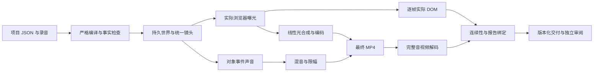

# OneTake 方法如何进入 HeiGe-Video

研究固定在 OneTake 提交 `2f5fbd363a0aec22055fbf62489380065737c91d`。逐文件分析见 [架构研究](onetake-architecture.md)，实际反例见 [质量研究](onetake-quality.md)。实现与示例由 HeiGe-Video 原创，沿用本项目已有的渲染、时钟、事实与素材契约。

## 选择可产生价值的方法

| 研究所得 | HeiGe-Video 的落地 | 当前边界 |
| --- | --- | --- |
| 同一对象贯穿动作 | 持久 DOM 对象、稳定 ID 与 semanticIdentity、完整关键帧 | semanticIdentity 是作者声明，不能自动证明观众认出了对象 |
| 镜头揭示空间关系 | 单个全局相机控制整个世界，随机 seek 得到同一状态 | 仿射二维投影，未实现真实三维景深与透视 |
| 每个边界有承接 | 每对 beat 声明 carrier、cause、outcome，测实际可见性与运动 | 结构通过不等于故事因果正确 |
| 声音跟着动作 | 事件时刻与画面共用时钟，源对象位置控制声像 | 原创三种合成材料与共用短延迟空间，需要另外听音 |
| 真实时间多采样 | 每个编码帧捕获三个浏览器状态，线性光合成 | 三次采样仍有有限重影，增加出片成本 |
| 自动质量反馈 | 实际 DOM 与最终 MP4 完整解码相互绑定 | 点阵遮挡和低分辨率像素没有图像语义 |

OneTake 的示例和规则强调导演判断。自动分数容易把形式条件当成成片质量。本次实际反例包括微小移动点、缺测、画外对象、静音片和单帧闪屏；它们限定了特定检测方法的能力，并不代表所有上游成片的质量。

## 与已有受控生产路线结合

内容仍从 `heige-video/4` 开始。普通镜头继续使用八类受控组件。需要跨镜头动作时，选择 `continuity` 和 `beat`，把物体与相机放在同一时间线上。编译器会拒绝混用，以免某类内容被静默忽略。

数字和界面行继续引用同一对象自己的事实，不借用另一镜的来源。真人录音仍是时钟，字幕保持最终音频的时码。中文字体从本地实际加载并检查 cmap。素材快照、输入指纹、引擎指纹和依赖记录继续约束交付状态。

## 原创模块的职责

| 模块 | 实际职责 |
| --- | --- |
| [continuity-contract.mjs](../studio/lib/continuity-contract.mjs) | 对象、相机、边界与声音字段的严格契约 |
| [continuous-motion.mjs](../studio/lib/continuous-motion.mjs) | 完整轨迹插值、投影与确定性 seek |
| [ContinuousStage.tsx](../studio/src/ContinuousStage.tsx) | 持久对象绘制与实际浏览器测量 |
| [blur_frames.mjs](../studio/blur_frames.mjs) | 真正的三曝光线性光 PNG 合成 |
| [event-audio.mjs](../studio/lib/event-audio.mjs) | 原创材料、事件时钟、声像与受限峰值 |
| [continuity-oracle.mjs](../studio/lib/continuity-oracle.mjs) | 完整帧覆盖、实际承接对象与最终像素绑定 |
| [continuity-evidence.mjs](../studio/lib/continuity-evidence.mjs) | verify 重算报告并拒绝错误时钟、失败状态与乱曝光编号 |
| [make.mjs](../studio/make.mjs) | init、doctor、validate、build、verify 的实际交付链路 |

输出目录不可自动覆盖。源码、字体、浏览器或项目改变后，既有产物不能沿用当前验收。历史五条 alpha 1 样片固定在原提交；连续样片采用独立清单。

## 经实际失败改进的环节

| 发现 | 已执行的改进 |
| --- | --- |
| 仅变宽变矮，面积几乎抵消 | 明确设计承接面板的形变与位移，保留实际边界拒绝记录 |
| 竖版文字影响遮挡点阵 | 在承接窗口前淡出退出文字，再重新出片 |
| 竖版收尾在技术通过后仍出现孤字与面板外文字 | 独立编码截帧拒绝该版本，采用两行各三个字、加高收尾面板并调整位置，再重渲三种画幅；增加生产组件与真实 Chrome 字形边界的回归 |
| 小数片长分别量化导致首尾差一帧 | 用累计边界差得到每段长度 |
| 单声道下混掩盖单侧峰值 | 保留全部声道检查，并对最终混音限幅 |
| 抽样静帧之间发生文字碰撞 | 正中曝光的每帧实际 probe 同时检查全局文字几何 |
| 失败媒体报告或乱曝光编号进入 verify | 复算实际报告，并检查媒体状态、编码时钟、编号与 manifest 一致性 |

这些机制为创作提供可测的基础。成片的节奏、表达、品牌气质和声音舒服程度，仍通过实际审阅判断。这里没有内置自动 LLM 调用、TTS、ASR 或在线素材采购，coding agent 可以基于这套契约创作自己的项目。
