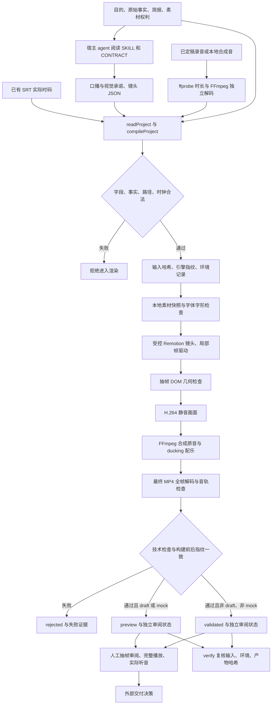

# HeiGe Video v4 alpha：从创作判断到可追溯成片

版本基准：`package.json` 的 `4.0.0-alpha.1`。本文描述当前 `studio/` 源码中的机制与边界，不作为任何示例已经通过渲染、审美或完整播放验收的证明。Brewreel 研究基准固定为 [`1bf00debaf81462c1d6a8365e8822764ba5fb910`](https://github.com/Finderchangchang/brewreel/tree/1bf00debaf81462c1d6a8365e8822764ba5fb910)，详细函数证据见 [brewreel-architecture.md](brewreel-architecture.md)。

## 系统的核心分工

创作 agent 负责题材理解、可讲述的中文、事实取舍、视觉承诺和镜头安排。当前自主计划能力来自宿主 agent 阅读 `SKILL.md`、参考资料及 `studio/CONTRACT.md`，再生成符合契约的 JSON。仓库没有在 `make.mjs` 中调用 LLM 自动写稿、自动分镜或自动修订的原生计划器。

受控生产器负责把已经明确的内容变成稳定的帧和文件。JSON 决定镜头、时间和素材，组件决定布局与动作，独立检查决定技术状态。表达自由留在 agent 与原创复杂镜头路线中，反复容易出错的执行约束交给编译器和 runner。

`validated` 的含义仅为技术检查成功。流程图中的人工审阅与交付决策目前由 agent 或使用者执行，runner 不会自动把它们改成通过，也不包含发布平台的提交动作。

## 同一份契约贯穿内容与画面

`studio/lib/project.mjs` 的 `compileProject()` 接受 `heige-video/4`，明确拒绝根对象和嵌套对象中的未知字段。输入包括主题、画幅、镜头、事实、素材、录音及配乐。返回值同时保留原始 `project`、量化后的 `timeline`、输出尺寸与帧率、`previewOnly` 和可定位的 `issues`。验证失败也返回问题，runner 在存在错误时停止。

当前镜头词汇为 `hook`、`statement`、`end`、`steps`、`compare`、`bars`、`transform`、`media`。`transform` 当前只有 `sort` 操作。`promo`、`explainer`、`lesson`、`talk` 是输入模式标签，共用这套执行器；它们没有各自独立的自动写课、ASR 或 B-roll 编排流水线。

`studio/src/Root.tsx` 根据编译计划设置 Composition 的帧数、宽高和帧率。`Film.tsx` 用 `Sequence` 切分镜头；`scenes.tsx` 的镜头只根据局部帧、计划和本地素材求画面。排序镜头保留同一条数据的 `id` 和 `value`，通过位置插值展示其排名变化，不用换一套内容来假装完成排序。`ledger` 和 `nocturne` 两个主题，以及横版、竖版、方版的布局规则由 `theme.ts` 管理。

这套组件适合信息讲解、步骤比较、数据动作和本地媒体拼接。精细产品三维、笔墨叙事、独特场景或更复杂因果动作，继续使用既有原创导演路线，必要时先渲染为本地图片或视频再通过 `media` 接入。增加组件应先证明动作成立，再定义可验证的字段与规格。

## 时钟先服从最终录音

有录音时，`make.mjs` 的 `checkedRead()` 先进行结构和路径检查，再用 ffprobe 获得实际时长，并独立解码录音检查有限采样值、静音、峰值及容器与解码时长差。随后把实测 `audioDuration` 传给 `compileProject()`。配乐不能代替一条缺失或静音的主录音。

镜头使用连续的 `start/end`，从录音零点覆盖到录音结束。编译器允许一帧量化误差，将结束边界统一换算为整数帧，并从前镜量化后的结束继续编排；最后一镜锁定实际录音对应的总帧数。每镜目前限定为 2 至 20 秒，全片不超过 600 秒。无录音时才使用各镜 `duration` 编排。直接调用编译器而未提供录音实测时长，只能得到带警告的结构检查，不能证明真实音画长度一致。

原音播放速度保持为 1。`mux()` 仅为帧量化尾差补齐或截取到目标片长，不通过拉伸音频挽救错误分镜。配乐默认音量为 0.15，存在主录音时通过 sidechain compression 降低配乐；媒体镜头中的视频默认静音，主声音统一在合成阶段处理。

`parseSrt()` 从整数毫秒解析已有字幕，保留每个 cue 的真实开始与结束，拒绝重叠、倒序和超出录音的时码。字幕显示清理句读标点，同时保留小数点、百分号及负号等数值含义。`Film.tsx` 根据全片 `frame/fps` 查找当前 cue，字幕不会按文字长度重新分摊时长。当前没有原生 ASR、强制对齐或词级时间戳生成器，已有 SRT 的正确性仍取决于上游与实际听音。

## 事实必须绑定到同一条引文

`facts` 保存来源 ID、原始文字与来源说明；镜头 `claims` 保存显示文字、事实 ID 和逐字引文。`validateClaims()` 要求引文属于被引用的同一条事实；提供简报时，引文还必须逐字存在于该简报。`claim.text` 必须逐字属于自己的 `quote`，不能把「1次」改写为「1小时」，也不能用乙的数据支持甲的结论。

`validateRows()` 要求数据行使用独立的合法 `claim.text` 片段：以本行标签开头，标签后使用空白、冒号、等号或有限关系词（如「有」「为」「获得」「耗时」），仅包含一个数量，不含其他行标签，值和柱图单位匹配。单位后的内容须结束、标点或约定说明词（如「记录」「测试」），避免「分」借用「分钟」的前缀。引文可以保留原上下文，但不能靠同一整句中标签与数字共现来交换主体的数据。镜头中其他含数值的标题、正文、步骤、比较项和媒体说明，也必须逐字属于本镜合法引文。数量检测覆盖全角数字与「八成」「百分之八十」等明确中文数量，并保留「一键」「一件事」这类普通文案。界面显示 claim 文字和来源 ID，便于复核。`demoData=true` 允许明确的教学数据，并在画面显示「教学示例数据　不代表真实业务」；它不能让已经填写的错误引文合法化。

这是降低错绑定和数字改写的机械约束，不能证明来源真实、样本完整、统计方法正确或结论成立。当前也没有自动联网事实核查器。审阅者仍需核对原始资料、数据口径、时间范围和可对外使用的表述。

## 素材在进入浏览器前固定

`resolveProjectFile()` 只接受项目目录内真实存在的相对路径，拒绝 URL、绝对路径、路径穿越及符号链接。图片只接受 PNG、JPG、JPEG、WebP；SVG 和 GIF 需在上游转成受控的静态图或视频。素材登记 `original`、`licensed`、`screenshot`、`generated` 与 `rights`，媒体画面显示相应来源类别。权利字段属于使用者声明，不等于程序完成授权审核。

`build()` 为输入素材生成 SHA-256，在临时本地 public 目录与交付 `assets/` 中建立快照，拷贝后核对哈希。浏览器消费受控本地资源，不按 JSON 任意请求外部 URL。字体从本地合法字体加载，`check_media.py prepare_font()` 检查所需中文及其他字形，输出本地字体；字体加载完成和提交后的布局完成才释放 Remotion 渲染等待。当前使用一个实际字体 face，浏览器可能合成粗体，这一限制写入环境和字体报告。

构建不隐式调用在线 LLM、TTS、图像或视频模型，也不隐式下载缺失浏览器。Remotion 的本地 bundle 服务仍属于正常执行过程。这里的本地资源约束用于确定性生产，不能扩大解释为操作系统级网络隔离。

## 状态与证据分开记录

| 状态或字段 | 当前含义 | 不包含的结论 |
| --- | --- | --- |
| `building` | 本次构建进行中 | 成片成功或任何验收通过 |
| `rejected` | 必需步骤失败或构建期间输入、引擎发生变化 | 可沿用其他版本的通过结论 |
| `preview` | 技术检查成功，但输入为 draft 或 mock 音频 | 正式录音或可直接交付 |
| `validated` | 非 draft、非 mock 的产物通过本次技术检查 | 审美、事实真实性、完整播放、听音或发布批准 |
| `review.visual` | 初始化为 `pending` | 程序自动看过并认可画面 |
| `review.realtimePlayback`、`audioListening` | 初始化为 `not-tested` | 由解码成功推导用户观看或听音体验 |

`inspectLayout()` 检查可见文字及 block 的边界、文字溢出、父容器裁切、文字内容一致性和文字相互遮挡。当前 runner 对每镜的 0／25／55／85％ 位置以及全片首尾执行实际浏览器 DOM 几何检查，并输出对应 proof；因此只覆盖实际记录的样本，不能保证所有过渡中间态均无几何问题。最终 MP4 的概览另有每镜约 72％ 的额外编码帧抽样，该抽样不属于 DOM 检查。

`check_media.py check()` 对最终编码 MP4 全部帧进行低分辨率像素解码，检查帧数、尺寸、帧率、时长和均匀空帧，报告长时间静止候选。同时完整解码最终音轨，检查存在性、有限采样值、静音、峰值和音画长度差。它从真实 MP4 提取概览 contact sheets，并为 `steps`、`compare`、`bars`、`transform` 输出更密的动作条。全帧低分辨率扫描可发现特定技术故障，但不能替代全分辨率视觉检查；长时间静止可能是合理阅读窗，保持为人工审阅候选。

任一必需步骤失败会产生 `rejected` manifest；已生成 MP4 改名为 `video.rejected.mp4`。视觉、完整播放、听音与交付决策需要单独留存所审产物的哈希、时间戳、缺陷和结论，当前 runner 没有专门的人工审阅记录写入命令。

## 哈希把结论绑定到版本

`inputFingerprint()` 记录项目 JSON、每个素材、字幕和可选简报的文件哈希。`engineFingerprint()` 记录执行相关的 `studio/` 代码、契约、锁文件与依赖声明等文件的综合哈希；测试文件不参与引擎指纹。环境记录包括依赖版本、Python 库、FFmpeg 与 ffprobe 版本、本地字体哈希与 face index，以及实际浏览器可执行文件哈希和版本。

`build()` 要求新目录或空目录，受控产物不覆盖已完成交付；串行锁与 Remotion `concurrency:1` 降低并行压力。构建结束前再次核对输入与引擎，避免编辑中的代码或素材继承已开始构建的验证状态。manifest 记录最终 MP4 哈希和已生成产物清单，包含计划、素材映射、图片与检查报告。

`verify()` 重新读取和校验项目，核对输入、引擎、依赖工具、字体浏览器、产物清单中的文件和最终 MP4，拒绝陈旧结论及 draft/mock 状态被错误提升。哈希机制用于检测已有清单对应的内容变化；manifest 本身尚无数字签名或外部可信时间戳，不能证明所有权或抵抗恶意重写整套清单。当前也没有素材供应器幂等 ledger、跨构建内容缓存或逐页渲染缓存。

## 从 Brewreel 吸收的机制及本版取舍

| 固定提交中的机制 | HeiGe v4 alpha 的落点 | 当前边界 |
| --- | --- | --- |
| 模型填有限 JSON、镜头组件承担执行 | `CONTRACT.md`、`compileProject()`、受控 `Scene` | 宿主 agent 计划；runner 无原生模型调用 |
| spec 限制文案、字段和时长 | strict 字段、镜头范围、事实与路径检查 | 尚无自动生成的组件 spec/prompt 注册表 |
| 最终声音驱动镜头 | 实测录音时长、连续帧边界、已有 SRT | 无自动 TTS、ASR、词级对齐 |
| 源码与输入变更不可继承 QA | 输入、引擎、环境及产物哈希 | 无数字签名及机器间可信复现证明 |
| 故障闸门、失败产物、manifest | `rejected`、`preview`、`validated` 与独立 review | 人工审阅未自动批准，交付未自动提交 |
| lesson 分页缓存和 engine lock | 当前只实现构建指纹与串行渲染锁 | 无 lesson 分页缓存、章节与自动课件脚本流水线 |
| B-roll 任务账本、付费幂等与复用 | 当前允许本地媒体输入 | 供应器、账本、费用预算与恢复未接 |

蒸馏方法保留六步：拆解参考的因果机制，私下复现最小原理，重新设计原创语言，组件化并限定输入，换陌生题材检验泛化，交给独立审阅。本文和当前实现没有把前两步的研究等同于完成陌生内容模型盲测，也没有复制参考项目的模板、角色、音乐或视频。

## 后续按 ROI 推进

1. 先闭合实际交付验收。用明确的新题材、最终真实录音、三种画幅验证完整生产流程，审阅最终 MP4 的动作、事实、阅读窗、全片播放与听音，把结果绑定到产物哈希。为短片与复杂片分别记录基线，不用渲染成功推导制作质量。
2. 扩展少量高复用动作。优先把常用解释动作（分类、合并、因果状态转换、真实产品操作）做成原创组件，每个组件配有限 spec、代表性难例和动作 proof。相较堆主题或泛用卡片，这一步更直接改善观众看到的内容。
3. 接入录音优先的字幕工具。先支持用户已有录音的 ASR 与强制对齐，再选择 TTS 适配器；保留真实时间戳与估算时间戳的区别。TTS 接入前需要明确本机资源限制、云供应器授权和失败策略，避免声音变化后继续复用旧字幕。
4. 建立受控原生计划器。让模型读取自动生成的组件规格、事实白名单和预算，输出严格 JSON；失败只回传具体契约错误并限制修订次数。用同一 brief、相同组件库与独立盲审评估不同模型，不预先承诺低成本模型达到高端模型质量。
5. 长片需求出现后再做增量缓存。将录音缓存、素材缓存与镜头渲染缓存拆开，以输入内容、实际字体及引擎指纹作为 key。先证明单镜复用不会混入旧状态，再接 lesson 分页、章节、课程封面及竖版重构。
6. 最后接外部 B-roll 供应器。以镜头语义和确切时窗生成任务，登记请求哈希、任务 ID、费用上限与状态；未知提交不重发，恢复优先查询原任务。机器技术通过与人工素材批准必须分开，生成素材和真实截图保留画面声明。

前三项主要提升真实使用价值和成片质量；后几项在已有可测基线后降低重复劳动与成本。每次扩大自主能力都应先补可验证的边界，再扩大可执行的动作范围。

当前入口：[studio/README.md](../studio/README.md)。运行命令见该文档，路径均相对于仓库根目录。
